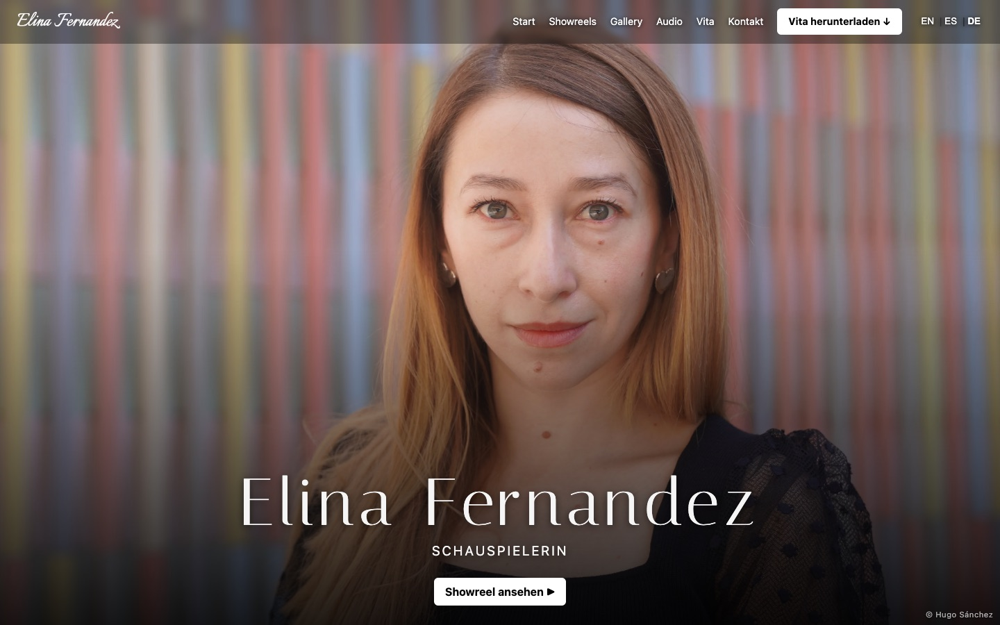

<div align="center">

# Elina Fernandez · Actress

**A one-page portfolio for casting directors, in German, English and Spanish.**

### 🌐 [pedrojrgarcia.github.io/actress-website](https://pedrojrgarcia.github.io/actress-website/)




</div>

---

## ✨ What the website does

| | |
| --- | --- |
| 🌍 **Three languages** | German, English and Spanish, switched with one click. Every text exists in all three, or the site isn't published. |
| 🎬 **Showreels** | Videos from Filmmakers, grouped by year or topic, with a language tag on each. |
| 🖼️ **Gallery** | Photos that open big when clicked, each with its photographer credit. |
| 🎙️ **Voice samples** | Audios grouped by language, with coloured tags: **DE**, **ES**, **EN**, **MULTI**. |
| 📅 **Upcoming events** | Premieres and readings, sorted by date. Past events disappear by themselves. |
| 🎭 **Vita** | Training, film and theatre, with posters, roles, directors and links. |
| 📄 **CV download** | One button that downloads the CV in the language the visitor is reading. |
| 📱 **Any screen** | Adapts to every screen, from a small phone to a wide desktop. |
| 🔒 **Privacy first** | No cookies, no tracking, fonts served from the site itself. Videos load only after a click. Impressum and privacy policy included. |

---

## 🚀 Commands

| Command          | What it does                                          |
| ---------------- | ----------------------------------------------------- |
| `npm install`    | Once, after downloading the project                   |
| `npm run dev`    | Local preview at http://localhost:5173 (live reload)  |
| `npm run deploy` | Checks, builds and publishes the site to GitHub Pages |

> **Note:** `git push` only saves the code. The live website changes only with `npm run deploy`.
> Step-by-step workflow and troubleshooting: [GUIDE.md](GUIDE.md).

---

## ✏️ How to update the content

Everything you normally change is in **`src/data/`** (content) and **`src/i18n/`** (translations).
Each file starts with a comment explaining how to edit it. You never need to touch `src/components/`.

| I want to change…                         | File                    |
| ----------------------------------------- | ----------------------- |
| Name, email, agency, links, CV files      | `src/data/profile.ts`   |
| "Über mich" details and skills (stars)    | `src/data/about.ts`     |
| Upcoming events                           | `src/data/events.ts`    |
| Videos                                    | `src/data/showreels.ts` |
| Photos                                    | `src/data/photos.ts`    |
| Audios                                    | `src/data/audios.ts`    |
| Vita: training, films, plays              | `src/data/vita.ts`      |
| Menu, buttons, headings, "Über mich" text | `src/i18n/texts.ts`     |
| Impressum, privacy policy                 | `src/i18n/legal.ts`     |
| Colours, fonts                            | top of `src/index.css`  |

- **Files** (photos, videos, CV) go in `public/` and are written in the data files by name only:
  `public/photos/1.webp` → `file: '1.webp'`.
- **Translations:** a text that changes with the language is written with all three side by side,
  `{ de: 'Kontakt', en: 'Contact', es: 'Contacto' }`. A text that is the same in every language is written once: `'Showreels'`.
  If a language is missing, the build stops with an error, so the site is never published half-translated.
- **Copyright:** photos, videos and audios show "© Elina Fernandez" unless you add `copyright: 'Other Name'`.

---

## 🗂️ Structure

```
public/                 files served as they are: vita-de.pdf, vita-en.pdf, vita-es.pdf, photos/, videos/
src/
├── data/               CONTENT – one file per section, plain lists
│   └── types.ts        the fields each list accepts (reference)
├── i18n/               TRANSLATIONS
│   ├── texts.ts        interface texts, DE / EN / ES side by side
│   ├── legal.ts        Impressum and privacy policy
│   └── index.ts        the languages, and t(): gives a text in the chosen language
├── components/         one file per part of the page, in page order:
│                       Header, Hero, About (+ Events), Showreels, Gallery, Audio, Vita, Contact, Footer
│                       ui.tsx: small shared pieces (section title, outside link, ©, language tag)
├── content.ts          prepares the data for the page: file addresses, sorting, hiding past events
├── App.tsx             puts the sections in order
├── index.css           all styles, in page order, with a table of contents at the top
└── main.tsx            starts the app
```

Same name everywhere: the Vita section is `data/vita.ts` → `components/Vita.tsx` → `#vita` → `.vita-…` styles.

---

## 🔒 Privacy

No cookies, no tracking, fonts served from the site itself. Filmmakers videos load only after a click,
audios only when played (see `src/i18n/legal.ts`).

---

<div align="center">

Built by **PedroG**, with help from Claude (Anthropic) for code and reviews.

</div>
